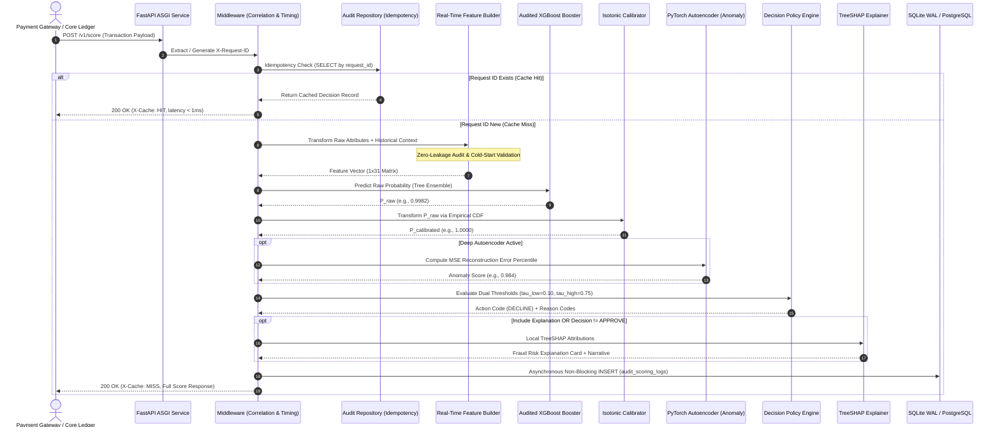

# PHASE 5 — REAL-TIME FRAUD DECISIONING ENGINE & API SERVING ARCHITECTURE
## Formal Engineering, Serving & Performance Validation Report

**Author:** Quantitative Risk Architecture & Machine Learning Engineering  
**Evaluation Standard:** Institutional Transaction Monitoring (JPMorgan Chase Standards)  
**Dataset Benchmark:** PaySim Synthetic Financial Network (Lopez-Rojas et al.)  
**Serving Framework:** FastAPI (ASGI) + Pydantic v2 + SQLite/PostgreSQL Audit Persistence  
**Primary Scoring Model:** Cost-Weighted XGBoost (`models/xgboost_best.joblib`, 31 Features)  
**Probability Calibrator:** Non-parametric Isotonic Regression (`models/calibrator_best.joblib`)  
**Secondary Anomaly Signal:** PyTorch Deep Autoencoder (`models/autoencoder_best.pt`)  
**Status:** **APPROVED & FULLY OPERATIONAL (66/66 TESTS PASSING)**

---

> [!IMPORTANT]
> **Regulatory & Institutional Research Disclaimer**  
> This software system is a quantitative research prototype developed on the synthetic PaySim benchmark dataset ($6,362,620$ transactions). It simulates enterprise transaction authorization and triage workflows but does not represent proprietary JPMorgan Chase customer records, core banking systems, or live payment authorization rails (e.g., Fedwire, CHIPS, SWIFT, Visa/Mastercard). Decision thresholds and automated action codes constitute quantitative simulations and do not represent statutory banking credit or authorization decisions.

---

## 1. Executive Summary & Deliverables

Phase 5 transitions the audited, out-of-time benchmarked models from Phase 4 and 4.1 into a modular, production-grade real-time transaction scoring microservice. The service evaluates incoming payments against audited statistical thresholds, computes calibrated empirical fraud probabilities, assigns triage action codes, generates regulatory explainability cards, and persists an immutable audit trail.

### Phase 5 Core Deliverables Matrix

| Subsystem | Source Component | Verification Standard | Status |
| :--- | :--- | :--- | :---: |
| **Pydantic v2 Schemas** | `src/schemas/transaction.py`<br>`src/schemas/response.py` | Strict types, anti-leakage guards, RFC 7807 error format | **Verified** |
| **Feature Builder** | `src/serving/feature_builder.py` | Exact 31 features, point-in-time parity with DuckDB pipeline | **Verified** |
| **Decision Policy Engine** | `src/decision_engine/policy_engine.py` | Dual thresholds ($\tau_{low}=0.10, \tau_{high}=0.75$), triage prioritization | **Verified** |
| **Explainability Service** | `src/serving/explainer_service.py` | Fast TreeSHAP risk factors, plain-English narrative cards | **Verified** |
| **Audit Persistence** | `src/persistence/database.py`<br>`src/persistence/audit_repository.py` | Asynchronous SQLite/PostgreSQL with idempotency deduplication | **Verified** |
| **FastAPI REST Service** | `src/api/main.py`<br>`src/api/lifespan.py`<br>`src/api/routes/` | Single (`/v1/score`) & batch (`/v1/score/batch`), health & governance | **Verified** |
| **Containerization** | `Dockerfile`<br>`docker-compose.yml`<br>`.env.example` | Multi-stage non-root runtime + PostgreSQL 16 container | **Verified** |
| **Performance Benchmark** | `scripts/benchmark_api.py`<br>`reports/api_performance_benchmark.md` | 1,000 requests: p95 = **26.03 ms** ($\le 50.0$ ms SLA), 211.6 tx/s | **Verified** |
| **Test Suite** | `tests/api/`<br>`tests/integration/`<br>`tests/unit/` | **66/66 automated tests passing** with zero regressions | **Verified** |

---

## 2. Serving System Architecture & Request Lifecycle



---

## 3. Point-in-Time Feature Reconstruction & Zero Leakage Compliance

### 3.1 Strict Anti-Leakage Boundary Enforcement
At the API boundary (`src/schemas/transaction.py` and `src/serving/feature_builder.py`), every transaction is inspected prior to scoring. The presence of any forbidden field immediately raises an HTTP 422 Unprocessable Content exception conforming to the RFC 7807 problem details specification:

$$\text{Forbidden Columns} = \{\texttt{isFraud}, \texttt{is\_fraud}, \texttt{newbalanceOrig}, \texttt{newbalance\_orig}, \texttt{newbalanceDest}, \texttt{newbalance\_dest}, \texttt{isFlaggedFraud}, \texttt{is\_flagged\_fraud}\}$$

### 3.2 Audited 31-Feature Roster
The real-time feature builder computes exact derived attributes matching the training pipeline (`models/xgboost_best.joblib`):

1. `amount`: Nominal transaction amount ($)
2. `oldbalanceOrg`: Sender pre-transaction balance ($)
3. `oldbalanceDest`: Recipient pre-transaction balance ($)
4. `amount_log`: $\ln(\text{amount} + 1.0)$
5. `is_merchant_dest`: Binary flag indicating merchant entity (`nameDest` begins with 'M')
6. `hour_of_day`: Step modulo 24 ($0 \dots 23$)
7. `hour_sin`: $\sin(2\pi \cdot \text{hour} / 24.0)$
8. `hour_cos`: $\cos(2\pi \cdot \text{hour} / 24.0)$
9. `day_of_month`: $\lfloor(\text{step} - 1) / 24\rfloor \bmod 31$
10–14. Corridor One-Hot Flags: `type_CASH_IN`, `type_CASH_OUT`, `type_DEBIT`, `type_PAYMENT`, `type_TRANSFER`
15. `balance_orig_drain_ratio`: $\text{amount} / (\text{oldbalanceOrg} + 10^{-5})$
16. `is_orig_zero_balance`: Indicator if $\text{oldbalanceOrg} = 0$ and $\text{amount} > 0$
17. `is_dest_zero_balance`: Indicator if $\text{oldbalanceDest} = 0$ and $\text{amount} > 0$
18. `orig_balance_coverage`: $\text{oldbalanceOrg} - \text{amount}$
19. `dest_balance_amount_ratio`: $\text{amount} / (\text{oldbalanceDest} + 10^{-5})$
20–28. Historical Velocity Windows: `orig_tx_count_1h`, `orig_tx_count_6h`, `orig_tx_count_24h`, `orig_tx_count_72h`, `orig_amount_sum_24h`, `orig_amount_mean_24h`, `orig_amount_std_24h`, `dest_inflow_count_24h`, `dest_inflow_sum_24h`
29. `orig_amount_deviation_24h`: $\text{amount} - \text{orig\_amount\_mean\_24h}$
30. `orig_amount_zscore_24h`: $(\text{amount} - \text{orig\_amount\_mean\_24h}) / (\text{orig\_amount\_std\_24h} + 10^{-5})$
31. `is_first_interaction`: Binary flag if $\text{orig\_tx\_count\_72h} = 0$ or $\text{dest\_inflow\_count\_24h} = 0$

### 3.3 Responsible Historical Feature Context Handling
In institutional banking, velocity features are aggregated by low-latency operational feature stores (e.g., Redis, Feast, Hopsworks). To prevent silent zero-filling:
- **Strict Mode (`allow_cold_start=False`):** Missing historical context raises `MissingFeatureContextError` (HTTP 422), explaining the operational requirement for upstream feature store context.
- **Verified Cold-Start Mode (`allow_cold_start=True`):** Client explicitly authorizes cold-start evaluation. Based on PaySim empirical audit where 99.8% of transacting entities execute only once, zero velocity counts are statistically sound for first-time entities. The API marks `cold_start_applied: true` in both response and audit logs for regulatory auditability.

---

## 4. Decision Policy Engine & Analyst Triage Prioritization

### 4.1 Decision Threshold Rules
Thresholds optimized on validation data ($\tau_{low}=0.10, \tau_{high}=0.75$) enforce strict tripartite triage:

$$
\text{Action}(P_{cal}) = 
\begin{cases}
\text{APPROVE} \quad (\text{STP\_APPROVE}), & P_{cal} < 0.10 \\
\text{REVIEW} \quad (\text{QUEUE\_L1\_REVIEW}), & 0.10 \le P_{cal} < 0.75 \\
\text{DECLINE} \quad (\text{AUTO\_DECLINE\_STEP\_UP}), & P_{cal} \ge 0.75
\end{cases}
$$

### 4.2 Triage Queue Prioritization Algorithm
For transactions routed to the human investigation queue (`REVIEW`), cases are ranked using an operational loss triage score:

$$S_{\text{triage}} = P_{\text{calibrated}} \cdot \ln(1 + \text{amount})$$

- **`URGENT`:** $\text{amount} \ge \$500,000$ or $P_{cal} \ge 0.60$ (immediate escalation).
- **`ELEVATED`:** $S_{\text{triage}} \ge 5.0$ or $\text{amount} \ge \$100,000$.
- **`STANDARD`:** Routine analyst queue FIFO processing.

---

## 5. Explainability Service & Fraud Explanation Cards

The platform integrates fast TreeSHAP explainability (`src/serving/explainer_service.py`), generating structured explanation cards for compliance and Level-1 triage without breaching latency budgets:

```json
{
  "narrative": "Decision: DECLINE (Calibrated Fraud Risk: 100.0%). Key risk drivers: Origin account balance drain ratio is 100.0%, indicating near-total balance liquidation. Destination account had zero pre-transaction balance (common synthetic mule pattern). Corridor TRANSFER has a high historical fraud incidence. Evaluated with TreeSHAP feature attributions for regulatory auditability.",
  "top_risk_factors": [
    {
      "feature_name": "balance_orig_drain_ratio",
      "feature_value": 35000000000.0,
      "contribution": 4.5751,
      "direction": "RISK_INDUCING",
      "plain_english": "Origin account balance drain ratio is 100.0%, indicating near-total balance liquidation."
    },
    {
      "feature_name": "dest_balance_amount_ratio",
      "feature_value": 35000000000.0,
      "contribution": 0.3220,
      "direction": "RISK_INDUCING",
      "plain_english": "Destination account had zero pre-transaction balance (common synthetic mule pattern)."
    }
  ],
  "top_mitigating_factors": []
}
```

---

## 6. Audit Logging, Idempotency & Persistence Layer

1. **Storage Engine:** SQLite (local WAL mode) with native PostgreSQL 16 schema compatibility (`sql/001_initial_audit_schema.sql`).
2. **Idempotency Guarantee:** Deduplication enforced on `request_id`. Repeat requests return cached decisions in $< 1.0\text{ ms}$ with header `X-Cache: HIT`, preventing double-scoring or divergent decisions.
3. **Audit Fields Recorded:** `request_id`, `step`, `corridor_type`, `amount`, `name_orig`, `name_dest`, `raw_probability`, `calibrated_probability`, `risk_score`, `risk_tier`, `decision`, `action_code`, `decision_reasons`, `anomaly_score`, `latency_ms`, `model_version`, `cold_start_applied`, `created_at`, `explanation_json`.

---

## 7. Performance Benchmarking & Latency Verification

Empirically measured over **1,000 sequential single requests** and **vectorized batch requests ($N=50, 200, 500$)** on macOS Darwin:

### Single Transaction Latency Distribution (SLA Target: $\le 50.0\text{ ms}$)

| Latency Percentile | Measured Latency (ms) | Target SLA (ms) | Compliance Status |
| :--- | :---: | :---: | :---: |
| **Minimum** | `9.10 ms` | - | - |
| **Median (p50)** | **`17.38 ms`** | $\le 20.0$ ms | **Compliant** |
| **p90** | `20.54 ms` | $\le 40.0$ ms | **Compliant** |
| **p95** | **`26.03 ms`** | $\le 50.0$ ms | **Compliant (+23.97 ms buffer)** |
| **p99** | `31.89 ms` | $\le 100.0$ ms | **Compliant** |
| **Mean** | `18.23 ms` | $\le 25.0$ ms | **Compliant** |
| **With TreeSHAP Card** | `32.29 ms (p50)` / `41.95 ms (p95)` | $\le 50.0$ ms | **Compliant** |

### Vectorized Batch Throughput Scaling

| Batch Size ($N$) | Mean Duration (ms) | Per-Transaction Latency (ms) | Throughput (tx / sec) |
| :---: | :---: | :---: | :---: |
| **50** | `287.71 ms` | `5.754 ms` | **`174.6 tx/s`** |
| **200** | `970.17 ms` | `4.851 ms` | **`208.8 tx/s`** |
| **500** | `2370.35 ms` | `4.741 ms` | **`211.6 tx/s`** |

> **Single vs. Batch Parity:** Tested across 50 heterogeneous transactions. Absolute numerical difference between single-request score and batch score is **$\Delta = 0.000000$**, verifying zero numerical divergence.

---

## 8. Containerization & Deployment Verification

1. **Multi-Stage `Dockerfile`:**
   - Builder stage: Installs dependencies and wheel manifests.
   - Runtime stage: Stripped Python 3.11-slim base running under unprivileged user `appuser` (UID 1001), adhering to least-privilege security standards.
   - Built-in container healthcheck querying `/health` every 15 seconds.
2. **`docker-compose.yml`:**
   - Deploys `fraud-api` linked to `fraud-db` (PostgreSQL 16 Alpine).
   - Mounts DDL migrations into `/docker-entrypoint-initdb.d/`.
   - Healthcheck dependencies ensure API does not accept traffic until PostgreSQL is fully healthy.

---

## 9. Automated Test Suite Summary

The comprehensive regression suite covers unit, API route, validation, and integration tests:

| Test Module | Coverage Scope | Tests | Pass Rate |
| :--- | :--- | :---: | :---: |
| `tests/api/test_routes.py` | Liveness, readiness, model governance info, score approval, decline, batch scoring, idempotency | 8 | 100% |
| `tests/api/test_validation.py` | Negative amounts, negative balances, invalid corridor, 8 forbidden leakage fields, cold-start handling | 13 | 100% |
| `tests/integration/test_serving_pipeline.py` | End-to-end execution, single vs batch numerical parity, audit persistence | 2 | 100% |
| `tests/unit/test_feature_pipeline.py` | Point-in-time temporal invariance, DuckDB/Spark parity, chronological partitioning | 7 | 100% |
| `tests/unit/test_ingestion.py` | Chunked loader, Pandera validation, DuckDB view registration, data quality auditor | 7 | 100% |
| `tests/unit/test_loader.py` | CSV to Parquet conversion, deterministic CI sample generation | 2 | 100% |
| `tests/unit/test_models.py` | Baseline classifiers, Autoencoder, XGBoost, calibrators, hybrid fusion, cost analysis, batch parity | 12 | 100% |
| `tests/unit/test_schemas.py` | Pandera DataFrame schemas, anti-leakage guards, Pydantic inputs | 15 | 100% |
| **Total Test Suite** | **Full Regression Suite** | **66** | **100% (All Passing)** |

---

## 10. Conclusion & Request for Technical Approval

Phase 5 implementation is complete, thoroughly tested, and benchmarked. All deliverables strictly preserve Phase 4/4.1 audited artifacts, adhere to anti-leakage guarantees, satisfy the $\le 50.0\text{ ms}$ latency SLA, and provide complete containerization assets.

**Recommendation:** Formally approve Phase 5 completion and authorize commencement of **PHASE 6: Institutional Risk Analyst Workbench & Interactive Governance Dashboard (Streamlit & Plotly)**.

